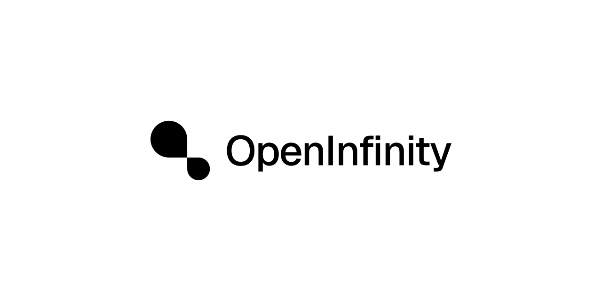

<p align="center"></p>

# OpenInfinity Design

[中文](#中文) · [English](#english)

## 中文

OpenInfinity 的品牌与设计资源：标志、应用图标、色彩、字体、动效、模板和品牌规范。

- **网站**：<https://design.open-infinity.com>
- **下载全部**：[OpenInfinity-Brand-Kit.zip](https://github.com/OpenInfinity/design/releases/latest/download/OpenInfinity-Brand-Kit.zip)
- **品牌规范 PDF**：[中文](assets/guidelines/openinfinity-brand-guidelines-zh.pdf) · [English](assets/guidelines/openinfinity-brand-guidelines-en.pdf)
- **使用前请阅读**：[商标使用条款](TRADEMARK.md)

### 目录

| 路径 | 内容 |
|---|---|
| `assets/logo/` | 图形标志、文字标志、横版与竖版组合，黑 / 白，SVG · PDF · PNG |
| `assets/app-icon/apple/` | iOS / iPadOS 资源目录、macOS `.icns` 与 `.iconset`、Icon Composer 分层 |
| `assets/app-icon/web/` | favicon、Apple Touch Icon、PWA 图标、manifest 与 `<head>` 示例 |
| `assets/app-icon/android/` | 自适应图标 `res/`（mdpi–xxxhdpi）与 Play 商店图标 |
| `assets/color/` | 色板：design tokens JSON、CSS、SCSS、Adobe ASE、GIMP GPL |
| `assets/motion/` | 开场、无限、加载动画：MP4、WebM（透明）、GIF、动画 SVG、Lottie |
| `assets/templates/` | 名片（含出血）、演示封面、会议背景、壁纸，中英两版 |
| `assets/social/` | 头像、GitHub 预览图、Open Graph、X 与 LinkedIn 横幅 |
| `assets/guidelines/` | 品牌规范 PDF（中 / 英） |
| `source/` | 标志与字标的矢量母版（字标已转曲） |
| `site/` | 网站源码（`index.html` 是中英双语模板，`scripts/pages.py` 由它生成英文版 `/` 与中文版 `/zh/`） |
| `scripts/` | 资源生成脚本 |

### 重新生成

需要 Python 3、`rsvg-convert`（librsvg）、`ffmpeg`；生成 `.icns` 需要 macOS 的 `iconutil`，打印 PDF 需要 Google Chrome。

```sh
./scripts/fetch-fonts.sh        # 下载 Geist 字体（OFL）
python3 scripts/build.py        # 标志、图标、色板、模板、社交图
python3 scripts/motion.py       # 动效（ProRes MOV 输出到 dist/）
python3 scripts/package.py      # 规范 PDF 与发布用压缩包
```

字标母版由 `scripts/wordmark.py` 从 Geist Medium 转曲生成（需要 `fonttools` 与 HarfBuzz 的 `hb-shape`）。

### 授权

- 标志、字标与名称是 OpenInfinity 的商标，保留所有权利，使用须遵守 [TRADEMARK.md](TRADEMARK.md)。
- `site/` 与 `scripts/` 中的代码采用 [MIT 许可证](LICENSE)。
- Geist 与思源黑体字体各自采用 SIL Open Font License 1.1（见 `site/fonts/OFL.txt`）。

## English

Brand and design resources for OpenInfinity: logo, app icons, color, type, motion, templates and guidelines.

- **Website**: <https://design.open-infinity.com>
- **Download everything**: [OpenInfinity-Brand-Kit.zip](https://github.com/OpenInfinity/design/releases/latest/download/OpenInfinity-Brand-Kit.zip)
- **Brand guidelines PDF**: [English](assets/guidelines/openinfinity-brand-guidelines-en.pdf) · [中文](assets/guidelines/openinfinity-brand-guidelines-zh.pdf)
- **Before you use the logo**: read the [trademark terms](TRADEMARK.md)

### Contents

| Path | What's inside |
|---|---|
| `assets/logo/` | Mark, wordmark, horizontal and vertical lockups in black / white — SVG · PDF · PNG |
| `assets/app-icon/apple/` | iOS / iPadOS asset catalog, macOS `.icns` and `.iconset`, Icon Composer layers |
| `assets/app-icon/web/` | Favicons, Apple touch icon, PWA icons, manifest and `<head>` snippet |
| `assets/app-icon/android/` | Adaptive icon `res/` (mdpi–xxxhdpi) and Play Store icon |
| `assets/color/` | Palette as design tokens JSON, CSS, SCSS, Adobe ASE and GIMP GPL |
| `assets/motion/` | Reveal, infinite and loading animations — MP4, WebM (alpha), GIF, animated SVG, Lottie |
| `assets/templates/` | Business card (with bleed), slide covers, video-call backgrounds, wallpapers — Chinese and English |
| `assets/social/` | Avatars, GitHub preview, Open Graph, X and LinkedIn banners |
| `assets/guidelines/` | Brand guideline PDFs (Chinese / English) |
| `source/` | Vector masters for the mark and the outlined wordmark |
| `site/` | Website source (`index.html` is a bilingual template; `scripts/pages.py` builds the English page at `/` and the Chinese page at `/zh/` from it) |
| `scripts/` | Asset build scripts |

### Rebuilding

Requires Python 3, `rsvg-convert` (librsvg) and `ffmpeg`; the `.icns` needs macOS `iconutil` and the PDFs need Google Chrome.

```sh
./scripts/fetch-fonts.sh        # download Geist (OFL)
python3 scripts/build.py        # logo, icons, color, templates, social
python3 scripts/motion.py       # motion (ProRes MOV goes to dist/)
python3 scripts/package.py      # guideline PDFs and release archives
```

The wordmark master is outlined from Geist Medium by `scripts/wordmark.py` (needs `fonttools` and HarfBuzz `hb-shape`).

### License

- The OpenInfinity name, mark and wordmark are trademarks of OpenInfinity; all rights reserved. See [TRADEMARK.md](TRADEMARK.md).
- Code in `site/` and `scripts/` is under the [MIT License](LICENSE).
- The Geist and Source Han Sans fonts are each under the SIL Open Font License 1.1 (see `site/fonts/OFL.txt`).
